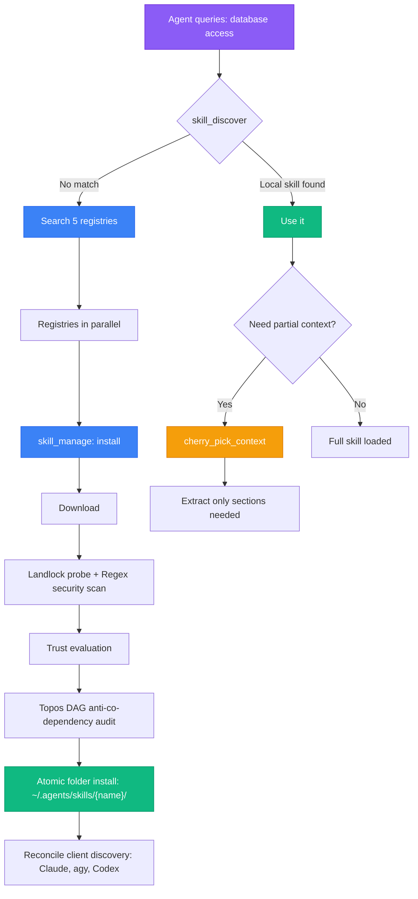
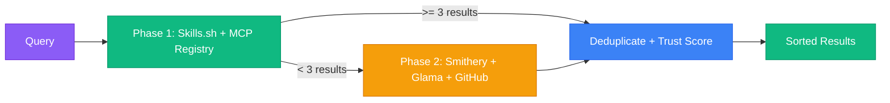
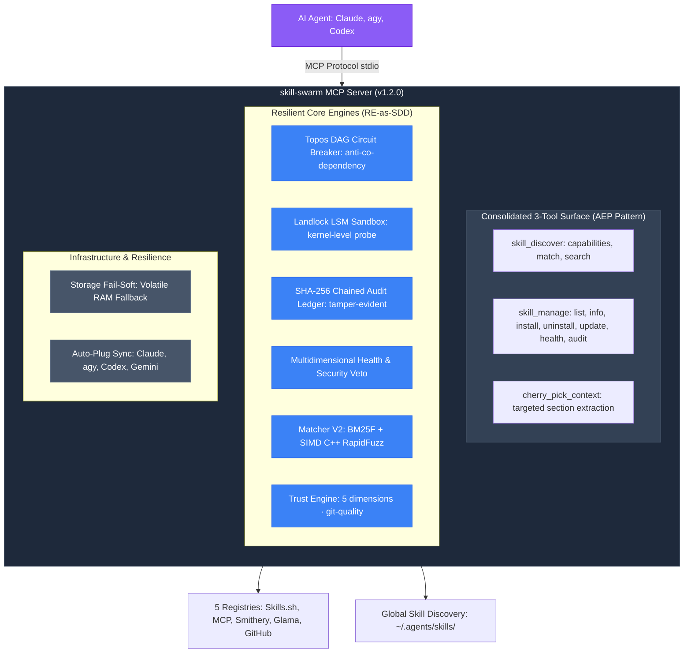
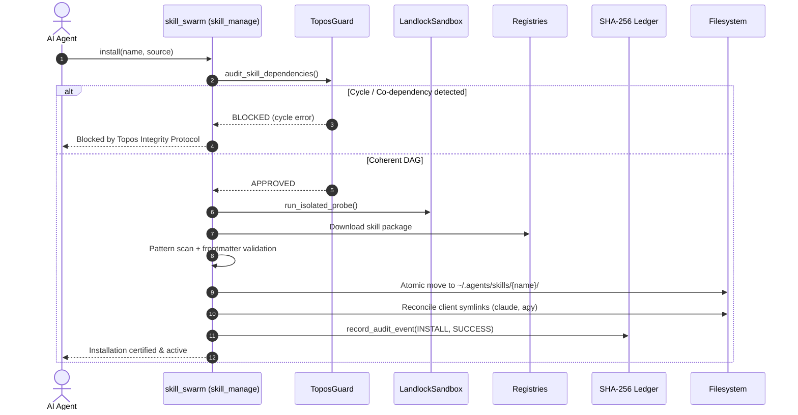
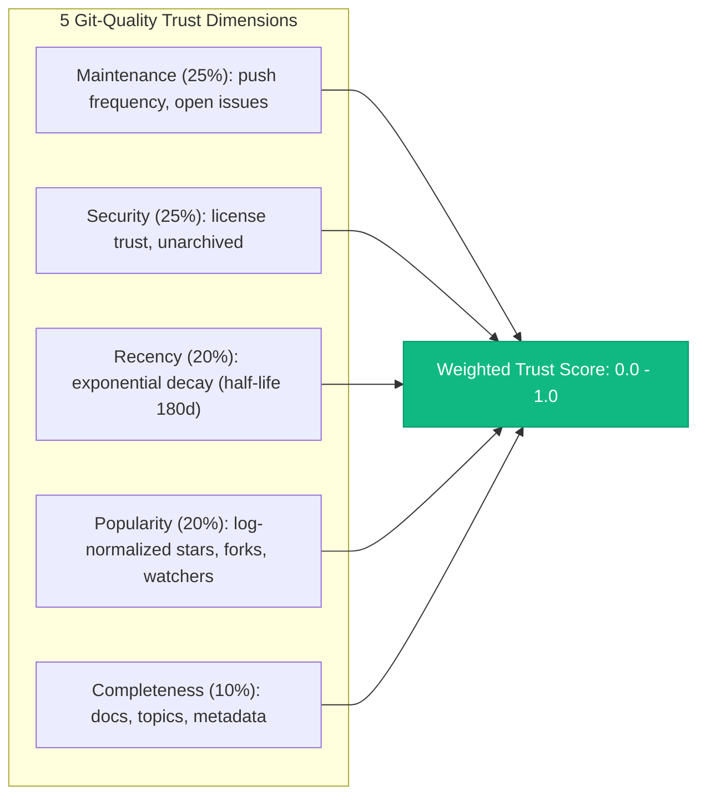
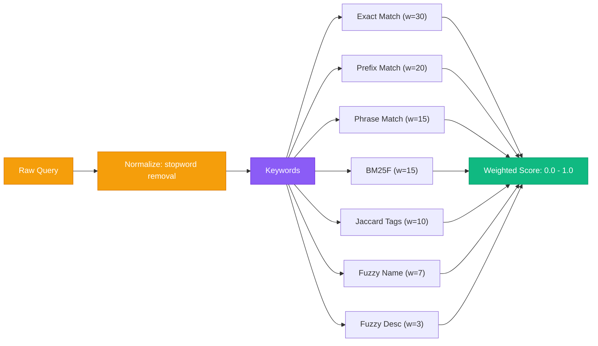

<a id="top"></a>

<div align="center">

# Skill Swarm

**MCP server for AI agent skill discovery, installation, and orchestration.**

[](LICENSE)
[](https://python.org)
[](https://modelcontextprotocol.io)
[]()
[](tests/)

</div>

---

## The Problem

AI agents (Claude, agy, Codex) need skills to be effective. Today, finding and installing the right skill for a task is manual:

1. Search Smithery/GitHub manually
2. Evaluate if the server is trustworthy (stars? license? maintained?)
3. Install and configure it by hand
4. Repeat for every project

**Skill Swarm automates the entire pipeline.** The agent queries "pdf parsing" and Skill Swarm searches 5 registries (Skills.sh, MCP Registry, Smithery, Glama, GitHub), evaluates trust, installs the best match, and makes it available instantly.

[↑ Back to top](#top)

---

## Active Pipeline Intent & Reinforcement Graph

### Intent: `feat:re_as_sdd_skill_swarm_aep_resilience` (Task ID 117)
Reverse Engineering as Software Design Document (RE-as-SDD) integration of Agent Execution Plane (AEP) resilience primitives into Skill Swarm MCP.

```mermaid
flowchart LR
    I["Intent: feat:re_as_sdd_skill_swarm_aep_resilience"] --> M1["M1: planned (Archon) ✅"]
    M1 --> M2["M2: documented (Graphos G1) ✅"]
    M2 --> M3["M3: audited (Ontos) ✅"]
    M3 --> M4["M4: implemented (Pragma) ✅"]
    M4 --> M5["M5: verified (Dokimos) ✅"]
    M5 --> M6["M6: documented (Graphos G2) ✅"]
    M6 --> M7["M7: committed (Hermon) ✅"]
```



[↑ Back to top](#top)

---

## How It Works



### Search Orchestration

Remote search uses a two-phase strategy — high-trust registries first, fallback only if needed:



### Architecture



### Install Pipeline



[↑ Back to top](#top)

---

## Quick Start

### Prerequisites

- **Python 3.12+** (validated through Python 3.14)
- **Git** (for cloning skill sources)
- **GitHub token** (optional, for 5000 req/hr vs 60)

### Autonomous Clean-Slate Provisioning (AEP Pattern)

If the host **lacks Python or package managers entirely**, or for a 1-command zero-root setup:

```bash
# Autonomous user-space provisioning (installs Astral uv + standalone hermetic Python 3.12+ + venv + registers clients)
./scripts/setup.sh

# Or verify toolchain health (100% read-only audit)
./scripts/setup.sh --check
```

### Manual Installation (Standard)

```bash
git clone https://github.com/ancrz/skill-swarm-mcp.git
cd skill-swarm-mcp

# Create virtual environment and install
python3 -m venv .venv
source .venv/bin/activate
pip install -e .

# Configure environment
cp .env.example .env

# Safely add your GitHub token without leaking it to shell history:
printf "Enter SKILL_SWARM_GITHUB_TOKEN (hidden): " && read -s val && echo && echo "SKILL_SWARM_GITHUB_TOKEN=$val" >> .env
```

> **Note on GitHub Token:** Skill Swarm uses the GitHub API to calculate Mathematical Trust Scores (stars, recent activity, issues) for skills. **If the token is missing, the system will completely skip raw GitHub searches** to prevent inventing inaccurate scores, and will automatically defer entirely to the official alternate registries (Smithery, MCP Registry, Skills.sh, Glama).

### Configure Your AI Agent Globally (Auto-Plug)

Run the autonomous synchronizer to register `skill-swarm` automatically across all detected AI environments:

```bash
./scripts/skill-swarm-sync.sh
```

Or configure manually:

#### Claude Code

Register it in the user scope:

```bash
claude mcp add skill-swarm \
  -- /home/ancruz/Documents/workspaces/skill-swarm-mcp/scripts/skill-swarm-mcp-launch.sh
```

#### Antigravity CLI (`agy`)

Add to `~/.gemini/config/mcp_config.json`:

```json
{
  "mcpServers": {
    "skill-swarm": {
      "command": "/home/ancruz/Documents/workspaces/skill-swarm-mcp/scripts/skill-swarm-mcp-launch.sh"
    }
  }
}
```

#### Codex

Codex consumes the canonical directory natively (`~/.agents/skills/`). To register the server in `~/.codex/config.json`:

```json
{
  "mcpServers": {
    "skill-swarm": {
      "command": "/home/ancruz/Documents/workspaces/skill-swarm-mcp/scripts/skill-swarm-mcp-launch.sh"
    }
  }
}
```

[↑ Back to top](#top)

---

## Consolidated 3-Tool Surface (AEP Pattern)

Skill Swarm groups capabilities into a consolidated surface matching AEP's orientation and lifecycle control plane design:

| Tool | Action Options | Description |
|---|---|---|
| **`skill_discover`** | `capabilities`, `discover`, `match`, `search` | Unified discovery router: returns autonomy manifest, matches locally, or queries 5 registries. |
| **`skill_manage`** | `list`, `info`, `install`, `uninstall`, `update`, `health`, `audit` | Unified lifecycle control plane: inventory, inspection, atomic install, health scoring, and SHA-256 audit. |
| **`cherry_pick_context`** | _(direct call)_ | Token-efficient extractor of specific markdown sections from SKILL.md. |

### Backward Compatibility Forwarders

For seamless compatibility with existing agent prompts, all legacy tools are preserved:

| Legacy Tool | Forwarded To |
|---|---|
| `search_skills(query, scope, limit)` | `skill_discover(action="search", query=...)` |
| `match_skills(task_description, threshold)` | `skill_discover(action="match", query=...)` |
| `install_skill(name, source, agents)` | `skill_manage(action="install", name=..., source=...)` |
| `uninstall_skill(name)` | `skill_manage(action="uninstall", name=...)` |
| `update_skill(name)` | `skill_manage(action="update", name=...)` |
| `list_skills(agent)` | `skill_manage(action="list", agent_filter=...)` |
| `get_skill_info(name)` | `skill_manage(action="info", name=...)` |
| `skill_health(name)` | `skill_manage(action="health", name=...)` |
| `verify_audit()` | `skill_manage(action="audit")` |

> [!NOTE]
> For the complete specification of all parameter schemas, return payloads, execution invariants, and the architectural gap analysis matrix, see the comprehensive [Tools Reference & Gap Analysis](TOOLS.md).

[↑ Back to top](#top)

---

## Skill Directory Compliance

Skills follow the Agent Skills standard with one user-global source:

```
~/.agents/skills/                   # Global source; Codex reads it directly
├── {skill-name}/
│   └── SKILL.md                    # Skill content (always SKILL.md)
├── manifest.json                   # Installed skills registry
├── audit.db                        # Tamper-evident SHA-256 chained audit ledger
├── .usage.json                     # Usage tracking data
└── .cache/                         # TTL-based search/trust cache

~/.claude/skills/                   # Agent-specific (symlinks)
├── {skill-name} -> ~/.agents/skills/{skill-name}
└── ...

~/.gemini/config/skills/            # agy current global path (symlinks)
├── {skill-name} -> ~/.agents/skills/{skill-name}
└── ...
```

- The **folder name** identifies the skill
- The **file** is always `SKILL.md` (standard compliance)
- Agent directories contain **directory symlinks** to the global source
- Legacy `~/.agent/skills/` content is migrated without overwriting conflicts

[↑ Back to top](#top)

---

## Trust Score Engine

Every remote search result includes a trust score (0.0-1.0) computed from 5 git-quality dimensions:



| Dimension        | Weight | Signals                                                            |
| ---------------- | ------ | ------------------------------------------------------------------ |
| **Recency**      | 0.20   | Exponential decay since last push (half-life: 180 days)            |
| **Popularity**   | 0.20   | Log-normalized stars, forks, watchers                              |
| **Maintenance**  | 0.25   | Push frequency, open issues ratio                                  |
| **Security**     | 0.25   | License trust level (MIT=1.0, GPL=0.5, none=0.1), archived penalty |
| **Completeness** | 0.10   | Description, homepage, topics, README presence                     |

**Verdicts:**

| Score     | Verdict     | Action                    |
| --------- | ----------- | ------------------------- |
| >= 0.75   | **TRUST**   | Safe to auto-install      |
| 0.50-0.74 | **CAUTION** | Show to agent for review  |
| 0.25-0.49 | **WARNING** | Manual review recommended |
| < 0.25    | **REJECT**  | Block installation        |

[↑ Back to top](#top)

---

## Matcher V2 — BM25F + Multi-Signal Scoring

Local skill matching uses 7 weighted signals:



| Signal            | Weight | Description                                          |
| ----------------- | ------ | ---------------------------------------------------- |
| Exact match       | 30     | Query equals skill name                              |
| Prefix match      | 20     | Skill name starts with query                         |
| Phrase match      | 15     | Query found as substring in any field                |
| BM25F             | 15     | Field-weighted relevance (name=3x, tags=2x, desc=1x) |
| Jaccard tags      | 10     | Set similarity on tags                               |
| Fuzzy name        | 7      | Typo-tolerant name matching (RapidFuzz C++ SIMD)     |
| Fuzzy description | 3      | Partial match on description                         |

[↑ Back to top](#top)

---

## Platform Support

| Platform    | Status       | Notes                                 |
| ----------- | ------------ | ------------------------------------- |
| **Linux**   | Full support | Landlock LSM sandboxing + pure ctypes |
| **macOS**   | Full support | Same Python ecosystem                 |
| **Windows** | Full support | Native symlinks supported             |

[↑ Back to top](#top)

---

## Project Structure

```
skill-swarm-mcp/
├── src/skill_swarm/
│   ├── server.py              # Consolidated 3-tool FastMCP server
│   ├── config.py              # Resilient storage fallback & Pydantic settings
│   ├── models.py              # Data models (SkillInfo, TrustScore, etc.)
│   ├── core/
│   │   ├── audit.py           # SPEC-2: SHA-256 chained audit ledger & masking
│   │   ├── topos.py           # SPEC-3: Topos DAG anti-co-dependency guard
│   │   ├── sandbox.py         # SPEC-4: Linux Landlock LSM in-process sandbox
│   │   ├── health.py          # SPEC-5: Multidimensional health & security veto
│   │   ├── installer.py       # Atomic install, symlink, and manifest pipeline
│   │   ├── scanner.py         # Regex & AST security pattern scanner
│   │   ├── matcher.py         # BM25F + multi-signal scoring (RapidFuzz)
│   │   ├── registry.py        # 5-registry parallel search
│   │   └── usage.py           # Resilient usage tracking
│   └── tools/
│       ├── inventory.py       # List, match, health, and audit tools
│       ├── search.py          # Multi-registry search implementation
│       ├── install.py         # Install, uninstall, update wiring
│       └── cherry_pick.py     # Targeted section extraction
├── scripts/
│   ├── setup.sh               # Clean-slate user-space provisioner & --check
│   ├── skill-swarm-mcp-launch.sh  # Hermetic Python FastMCP launcher
│   └── skill-swarm-sync.sh    # Pre-flight validator & multi-client auto-plug
├── docs/
│   ├── blueprint_re_sdd.md    # RE-as-SDD formal specifications (SPECs 1-5)
│   ├── PROJECT.md             # Project premise and active intent
│   ├── MILESTONES.md          # Pipeline milestone tracking
│   └── COMPACT.md             # Context compaction instructions
├── tests/
│   ├── conftest.py            # Isolated tmp_path test fixture
│   ├── test_re_sdd_resilience.py  # SPECs 1-5 validation suite
│   ├── test_core.py           # Core unit tests (25)
│   ├── test_e2e_effectiveness.py  # E2E V1 (19 tests)
│   └── test_e2e_v2.py         # E2E V2 — trust, cache, BM25F (19 tests)
├── LICENSE                    # Apache 2.0
├── README.md                  # Single source of truth documentation
├── TOOLS.md                   # Complete toolchain reference & gap analysis
└── pyproject.toml             # Python package config (v1.2.0)
```

[↑ Back to top](#top)

---

## Development & Testing

```bash
# Verify system health (100% read-only audit)
./scripts/setup.sh --check

# Run full test suite (68 tests, 100% pass)
.venv/bin/python -m pytest tests/

# Run resilience test suite specifically
.venv/bin/python -m pytest tests/test_re_sdd_resilience.py
```

[↑ Back to top](#top)

---

## License and Terms

This project is licensed under the terms of the **Apache License 2.0**. Refer to the [`LICENSE`](LICENSE) file for the full terms and conditions of use, reproduction, distribution, and patent grants.

- **Compatibility**: Permissive and enterprise-friendly, compatible with MIT, BSD-3-Clause, and public-domain databases (SQLite).
- **Patent Grant**: Features bilateral patent defense and licensing protections (Section 3 of Apache 2.0).
- **Disclaimer of Warranty & Limitation of Liability**: Software provided on an "AS IS" basis without warranties or conditions of any kind (Sections 7 & 8 of Apache 2.0).

```
Copyright 2025 Anthony Cruz
```

<div align="center">

**Built with FastMCP Protocol and Topos Pipeline Engineering.**

[↑ Back to top](#top)

</div>
