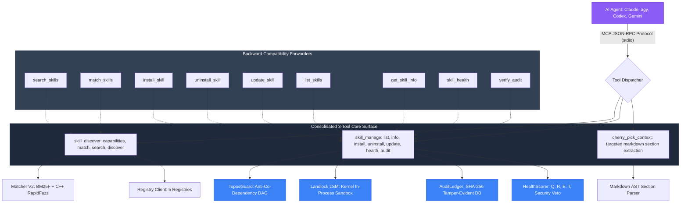

<a id="top"></a>

# Skill Swarm MCP — Complete Toolchain Reference & Gap Analysis

Comprehensive technical reference for the **Skill Swarm MCP Server** (v1.2.0).

This document serves as the canonical specification for all exposed tools, operational parameters, security invariants, error handling, backward-compatibility forwarders, and identified architectural gaps for future evolution.

---

## Table of Contents

- [Architectural Topology](#architectural-topology)
- [Consolidated 3-Tool Surface (AEP Pattern)](#consolidated-3-tool-surface-aep-pattern)
  - [`skill_discover`](#1-skill_discover)
  - [`skill_manage`](#2-skill_manage)
  - [`cherry_pick_context`](#3-cherry_pick_context)
- [Backward Compatibility Forwarders](#backward-compatibility-forwarders)
- [Resilience Primitives & Security Invariants (SPECs 1–5)](#resilience-primitives--security-invariants-specs-15)
- [Data Models & Schema Specifications](#data-models--schema-specifications)
- [Configuration & Environment Variables](#configuration--environment-variables)
- [Gap Analysis & Future Improvements](#gap-analysis--future-improvements)

[↑ Back to top](#top)

---

## Architectural Topology

Skill Swarm groups tools into a unified 3-tier plane inspired by the **Agent Execution Plane (AEP)**:
1. **Discovery & Orientation Plane** (`skill_discover`): Capabilities manifest, BM25F local matching, and 5-registry federated search.
2. **Lifecycle Control Plane** (`skill_manage`): Inventory, inspection, atomic installation with Landlock LSM and Topos DAG validation, health scoring, and SHA-256 audit verification.
3. **Context Optimization Plane** (`cherry_pick_context`): High-precision AST markdown section extraction to minimize token usage.



[↑ Back to top](#top)

---

## Consolidated 3-Tool Surface (AEP Pattern)

### 1. `skill_discover`

Unified orientation, local skill matching, and remote multi-registry search tool.

#### Signature
```python
async def skill_discover(
    action: str = "discover",
    query: str | None = None,
    scope: str = "all",
    limit: int = 5,
) -> str
```

#### Parameters

| Parameter | Type | Default | Description |
|---|---|---|---|
| `action` | `string` | `"discover"` | Action mode: `"capabilities"`, `"discover"`, `"match"`, `"search"`. |
| `query` | `string \| null` | `null` | Query terms, task description, or capability keyword. |
| `scope` | `string` | `"all"` | Scope for `"search"` action: `"all"`, `"local"`, `"remote"`. |
| `limit` | `integer` | `5` | Maximum number of results to return (capped at 20). |

#### Action Modes

1. **`action="capabilities"`**:
   Returns the autonomous server manifest, active version (`1.2.0`), implemented resilience SPECs (1–5), supported registries, and tool mapping. Does not require `query`.
2. **`action="discover"`**:
   Two-tier cascading discovery. First queries local skills using BM25F (`threshold=0.05`). If matching local skills are found, returns them with `source: "local"`. If no local match exists, falls back to querying remote registries with `source: "remote"`.
3. **`action="match"`**:
   Explicit local matching against installed skills in `~/.agents/skills/`. Computes BM25F keyword and RapidFuzz fuzzy similarity scores.
4. **`action="search"`**:
   Explicit multi-registry search across 5 registries (Skills.sh, MCP Registry, Smithery, Glama.ai, GitHub) with trust scoring and deduplication.

#### Example: Querying Capabilities Manifest
```json
// Request
{
  "action": "capabilities"
}

// Response (truncated)
{
  "status": "OK",
  "server": "skill-swarm",
  "version": "1.2.0",
  "resilience_specs": {
    "SPEC-1": "Resilient storage with pre-flight writability and volatile RAM fallback",
    "SPEC-2": "Tamper-evident SHA-256 chained audit ledger and credential masking",
    "SPEC-3": "Topos Integrity Circuit Breaker (Anti-co-dependency DAG)",
    "SPEC-4": "User-space Landlock LSM sandboxing probe (pure ctypes libc.so.6)",
    "SPEC-5": "Multidimensional skill health and trust scoring (Q, R, E, T, Security Veto)"
  },
  "registries": ["Skills.sh", "MCP Registry", "Smithery", "Glama.ai", "GitHub"]
}
```

[↑ Back to top](#top)

---

### 2. `skill_manage`

Unified lifecycle control plane managing inventory, inspection, installation, removal, health diagnostics, and audit ledger integrity.

#### Signature
```python
async def skill_manage(
    action: str,
    name: str | None = None,
    source: str | None = None,
    agents: str = "claude,agy,codex",
    agent_filter: str = "all",
) -> str
```

#### Parameters

| Parameter | Type | Default | Description |
|---|---|---|---|
| `action` | `string` | _(required)_ | Action mode: `"list"`, `"info"`, `"install"`, `"uninstall"`, `"update"`, `"health"`, `"audit"`. |
| `name` | `string \| null` | `null` | Name of the skill. Required for `"info"`, `"install"`, `"uninstall"`, `"update"`, and optional for `"health"`. |
| `source` | `string \| null` | `null` | Source URL, git clone URL, or local path. Required for `"install"`. |
| `agents` | `string` | `"claude,agy,codex"` | Comma-separated list of agent clients to link upon installation. |
| `agent_filter` | `string` | `"all"` | Filter installed skills by target agent in `"list"` (`"all"`, `"claude"`, `"agy"`, `"codex"`). |

#### Action Modes & Security Protocols

1. **`action="list"`**:
   Lists all installed skills in `~/.agents/skills/` along with directory symlink status (`linked`, `native`, `unmanaged directory`, `missing`), usage counts, and multidimensional health scores.
2. **`action="info"`**:
   Inspects complete metadata, `manifest.json` fields, `SKILL.md` content, and detailed usage statistics.
3. **`action="install"`**:
   Executes safe atomic installation under the **Topos Integrity Protocol**:
   - **Step 1: Topos Dependency Audit**: Verifies declared skill dependencies. Blocks installation if cycles or co-dependencies are detected (`SkillToposGuard`).
   - **Step 2: Landlock LSM Sandbox Probe**: Pure `ctypes` Linux Landlock LSM probe (`libc.so.6`) isolates download operations with fail-soft fallback.
   - **Step 3: Pattern & Regex Scan**: Scans contents for prompt injections, credential exfiltration, and dangerous subprocess patterns.
   - **Step 4: Atomic Deployment**: Clones/downloads to temporary directory, verifies `SKILL.md`, and atomically renames to `~/.agents/skills/{name}/`.
   - **Step 5: Symlink Reconciliation**: Reconciles client directories (`~/.claude/skills/`, `~/.gemini/config/skills/`).
   - **Step 6: Cryptographic Audit**: Records tamper-evident event in `audit.db` with SHA-256 hash chaining and secret masking.
4. **`action="uninstall"`**:
   Safely removes the skill directory, purges agent symlinks, removes entries from `manifest.json`, and records an `UNINSTALL` event in the audit ledger.
5. **`action="update"`**:
   Checks origin repository, re-verifies trust, stages update atomically, and preserves local tracking.
6. **`action="health"`**:
   Evaluates multidimensional health score ($H = 0.35Q + 0.30R + 0.15E + 0.20T$). If `name` is omitted, returns fleet-wide health and dead skill detection. If `name` is specified, returns deep diagnostics with dimension breakdown and security veto status.
7. **`action="audit"`**:
   Verifies cryptographic integrity of the SHA-256 chained audit ledger (`audit.db`). Re-calculates every block hash from genesis, verifying zero tamper, deletion, or backdating.

#### Example: Verifying the Audit Chain
```json
// Request
{
  "action": "audit"
}

// Response
{
  "valid": true,
  "verified": true,
  "events_verified": 42,
  "head_hash": "a4f5b892c90321f87e35b71289cf004925890fa18712a48bcde6912304918231",
  "genesis_hash": "0000000000000000000000000000000000000000000000000000000000000000",
  "tamper_detected": false
}
```

[↑ Back to top](#top)

---

### 3. `cherry_pick_context`

High-precision token-saving extractor that returns only requested markdown sections from an installed skill's `SKILL.md`.

#### Signature
```python
async def cherry_pick_context(
    skill_name: str,
    sections: list[str],
) -> str
```

#### Parameters

| Parameter | Type | Default | Description |
|---|---|---|---|
| `skill_name` | `string` | _(required)_ | Target installed skill name. |
| `sections` | `list[string]` | _(required)_ | Header titles to extract (e.g., `["Quick Start", "API Reference"]`). |

#### Return Structure
```json
{
  "skill_name": "docker-tools",
  "requested_sections": ["Quick Start", "API Reference"],
  "found_sections": ["Quick Start"],
  "missing_sections": ["API Reference"],
  "content": "## Quick Start\n\nRun `docker ps` to verify active containers...",
  "tokens_saved_estimate": 4500,
  "original_bytes": 18450,
  "extracted_bytes": 1240
}
```

[↑ Back to top](#top)

---

## Backward Compatibility Forwarders

For legacy agent workflows and external integrations, all 9 historic tools are preserved as zero-overhead forwarders:

| Legacy Tool | Parameters | Forwarding Route | Purpose |
|---|---|---|---|
| `search_skills` | `query`, `scope="all"`, `limit=5` | `skill_discover(action="search", ...)` | Multi-registry remote search |
| `match_skills` | `task_description`, `threshold=0.05` | `skill_discover(action="match", ...)` | Local BM25F skill matcher |
| `install_skill` | `name`, `source`, `agents="claude,agy,codex"` | `skill_manage(action="install", ...)` | Atomic skill installer |
| `uninstall_skill` | `name` | `skill_manage(action="uninstall", ...)` | Skill removal & symlink cleanup |
| `update_skill` | `name` | `skill_manage(action="update", ...)` | Origin source update |
| `list_skills` | `agent="all"` | `skill_manage(action="list", ...)` | Inventory & symlink health |
| `get_skill_info` | `name` | `skill_manage(action="info", ...)` | Deep metadata & content read |
| `skill_health` | `name=None` | `skill_manage(action="health", ...)` | Usage & dead skill detection |
| `verify_audit` | _(none)_ | `skill_manage(action="audit")` | SHA-256 ledger verification |

[↑ Back to top](#top)

---

## Resilience Primitives & Security Invariants (SPECs 1–5)

Ported from **Agent Execution Plane (AEP)** via Reverse Engineering as Software Design Document (RE-as-SDD):

### SPEC-1: Storage Fail-Soft & RAM Volatile Fallback
- **Pre-flight writability check** (`check_storage_writability`): Tests directory writability by creating, writing, and unlinking a transient `.test_write` marker.
- **Fail-soft RAM fallback**: If the primary storage path (`~/.agents/skills`) is located on a read-only filesystem (e.g. strict container or CI sandbox), Skill Swarm falls back to `/tmp/skill_swarm_ram_{uid}` or an in-memory mock store, logging a warning rather than crashing.

### SPEC-2: Tamper-Evident SHA-256 Chained Audit Ledger
- **Cryptographic Chaining**: Every lifecycle event (INSTALL, UNINSTALL, UPDATE, AUDIT) writes a block to SQLite `audit.db`:
  $$\text{Hash}_n = \text{SHA-256}(\text{Index}_n \parallel \text{Timestamp}_n \parallel \text{Event}_n \parallel \text{Payload}_n \parallel \text{Hash}_{n-1})$$
- **Secret Redaction**: Any API keys, bearer tokens, or sensitive credentials matching pattern `(token|key|secret|password)=...` are replaced with `[REDACTED_SECRET]` before hashing to prevent credential leaks in immutable logs.

### SPEC-3: Topos DAG Circuit Breaker (Anti-Co-Dependency)
- **Mathematical Invariant**: Validates dependency graphs using Kahn's algorithm and Depth-First Search cycle detection.
- **Strict Prohibition**: Co-dependent relationships ($A \leftrightarrow B$ circular coupling) are strictly rejected with error `CO_DEPENDENCY_CYCLE_DETECTED`, preserving system stability.

### SPEC-4: User-Space Landlock LSM Sandbox Probe
- **Kernel-level Sandboxing**: Direct system call binding via `ctypes.CDLL("libc.so.6")` invoking syscalls `444` (`landlock_create_ruleset`), `445` (`landlock_add_rule`), and `446` (`landlock_restrict_self`).
- **Graceful Degradation**: On non-Linux kernels (macOS, Windows) or unprivileged environments where Landlock is absent or disabled, the sandbox probe returns `landlock_supported=False` with status `FAIL_SOFT_ACTIVE`, falling back to AST pattern scanning.

### SPEC-5: Multidimensional Health & Security Veto
- **Mathematical Model**:
  $$\text{Score} = 0.35 \times Q + 0.30 \times R + 0.15 \times E + 0.20 \times T$$
  Where $Q$ = Quality/Success rate, $R$ = Recency exponential decay ($T_{1/2} = 180\text{d}$), $E$ = Execution frequency, and $T$ = Test/Symlink validation.
- **Security Veto**: If any security scanner detect dangerous payloads (prompt injection, unauthorized socket creation, arbitrary code execution), $\text{Score}$ is instantly forced to $0.0$, verdict set to `REJECT`, and installation is aborted.

[↑ Back to top](#top)

---

## Data Models & Schema Specifications

### `SearchResult`
```json
{
  "name": "docker-manager",
  "description": "Comprehensive container management and docker-compose orchestration",
  "source": "Skills.sh",
  "url": "https://skills.sh/docker-manager",
  "tags": ["docker", "containers", "devops"],
  "trust": {
    "score": 0.89,
    "confidence": 0.95,
    "verdict": "TRUST",
    "dimensions": {
      "recency": 0.92,
      "popularity": 0.85,
      "maintenance": 0.90,
      "security": 1.00,
      "completeness": 0.80
    }
  }
}
```

### `SkillInfo`
```json
{
  "name": "docker-manager",
  "description": "Container management tools",
  "version": "1.2.0",
  "tags": ["docker", "containers"],
  "source": "https://skills.sh/docker-manager",
  "agents": ["claude", "agy", "codex"],
  "installed_path": "/home/user/.agents/skills/docker-manager",
  "installed_at": "2026-10-29T23:45:00Z"
}
```

### `AuditVerificationResult`
```json
{
  "valid": true,
  "verified": true,
  "events_verified": 14,
  "head_hash": "e3b0c44298fc1c149afbf4c8996fb92427ae41e4649b934ca495991b7852b855",
  "genesis_hash": "0000000000000000000000000000000000000000000000000000000000000000",
  "tamper_detected": false,
  "discrepancies": []
}
```

[↑ Back to top](#top)

---

## Configuration & Environment Variables

All settings are configured via environment variables prefixed with `SKILL_SWARM_` or in a local `.env` file:

| Variable | Type | Default | Description |
|---|---|---|---|
| `SKILL_SWARM_SKILLS_DIR` | `Path` | `~/.agents/skills` | Global skill repository root. |
| `SKILL_SWARM_GITHUB_TOKEN` | `string` | _(empty)_ | GitHub Personal Access Token (boosts rate limit from 60 to 5000 req/hr). |
| `SKILL_SWARM_CACHE_SEARCH_TTL` | `integer` | `3600` | Search result cache TTL in seconds. |
| `SKILL_SWARM_CACHE_TRUST_TTL` | `integer` | `86400` | Trust score cache TTL in seconds (24h). |
| `SKILL_SWARM_SEARCH_TIMEOUT` | `float` | `15.0` | Maximum timeout for remote HTTP registry requests. |
| `SKILL_SWARM_SEARCH_MAX_RESULTS` | `integer` | `10` | Default result cap for search queries. |
| `SKILL_SWARM_SECURITY_THRESHOLD` | `float` | `0.5` | Minimum security score required to permit installation. |
| `SKILL_SWARM_SKILLSSH_ENABLED` | `boolean` | `true` | Enable Skills.sh primary registry query engine. |
| `SKILL_SWARM_SKILLSSH_NPX_PATH` | `string` | `"npx"` | Path to the `npx` executable for `skills find`. |
| `SKILL_SWARM_SKILLSSH_GITHUB_FALLBACK` | `boolean` | `true` | Fallback to GitHub topic search when npx is unavailable. |
| `SKILL_SWARM_ENABLE_LANDLOCK` | `boolean` | `true` | Enable Linux Landlock LSM in-process sandbox probe. |
| `SKILL_SWARM_AUDIT_LOG_ENABLED` | `boolean` | `true` | Enable SHA-256 chained audit ledger logging. |

[↑ Back to top](#top)

---

## Gap Analysis & Future Improvements

To maintain architectural transparency and guide continuous evolution, the following gaps and enhancement opportunities are identified:

| Gap ID | Domain | Current State (v1.2.0) | Target State & Future Improvement | Impact / Priority |
|---|---|---|---|---|
| **GAP-1** | **Registry Synchronization** | Periodic TTL caching (1h search, 24h trust). Remote registries are polled on demand. | Implement HTTP `ETag` / `If-None-Match` conditional polling and Webhook/SSE subscriptions for instant registry invalidation. | Medium — Reduces redundant HTTP traffic. |
| **GAP-2** | **Distributed Multi-Node Storage** | Local filesystem (`~/.agents/skills`) with in-memory RAM fallback. | Add remote storage adapters (S3, GCS, Cloudflare R2, SQLite VFS) to support multi-agent distributed clusters sharing a skill fleet. | High — Enables enterprise multi-agent swarms. |
| **GAP-3** | **Standalone Go Micro-Binary Extraction** | Python-based FastMCP server with RapidFuzz C++ extension for BM25F ranking. | Compile an optional Go / Rust standalone micro-binary for execution in RAM (`memfd_create` pattern from AEP) on low-resource headless embedded nodes lacking Python entirely. | Medium — Zero-dependency standalone execution. |
| **GAP-4** | **Cross-Platform OS Sandboxing** | Linux-native Landlock LSM via `ctypes` (`libc.so.6`). Fails soft on macOS / Windows. | Integrate macOS Seatbelt (`sandbox_init`) and Windows AppContainer / Job Object sandboxing bindings for universal OS kernel isolation. | High — Defense-in-depth across macOS/Windows developers. |
| **GAP-5** | **Event-Driven Hot Reloading** | Agents poll or invoke `skill_manage(action='list')` to detect filesystem changes. | Add in-process `inotify` / `ReadDirectoryChangesW` file watcher to emit MCP Resource Notifications (`notifications/resources/updated`) when skills are modified out-of-band. | Medium — Zero-latency agent context updates. |
| **GAP-6** | **Skill Semantic Embeddings Cache** | Hybrid lexical BM25F + 7-signal RapidFuzz scoring. | Integrate optional local ONNX / GGUF small embedding model (e.g. `all-MiniLM-L6-v2`) for hybrid vector-lexical semantic skill retrieval without network latency. | Low — Improves semantic recall on ambiguous task descriptions. |

[↑ Back to top](#top)
